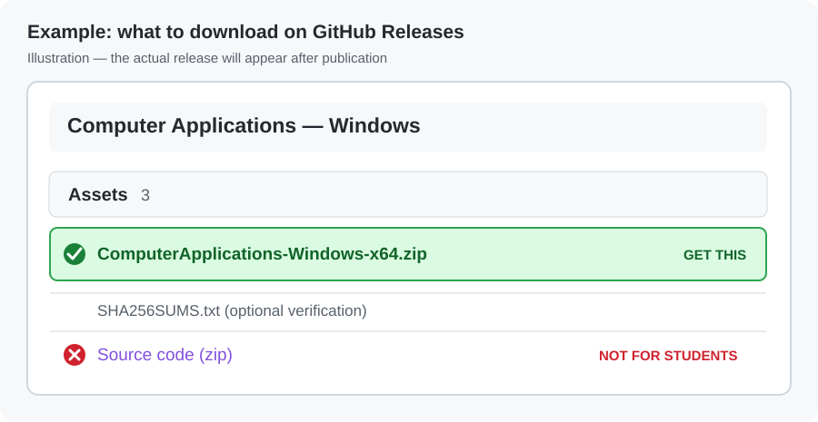

# Computer Applications — Learn IT at Home

**Free, offline practice for Windows 10 and 11.** Work through beginner-friendly IT lessons, networking exercises, and simulated computer labs at your own pace.

## Download Computer Applications

**[⬇ DOWNLOAD COMPUTER APPLICATIONS FOR WINDOWS](https://github.com/dylanmcicero/computerapps-student/releases/latest/download/ComputerApplications-Windows-x64.zip)**

[See the latest release details](https://github.com/dylanmcicero/computerapps-student/releases/latest)

> **Available now — Windows 10/11 (64-bit).** Select the ZIP download above. Your posted classroom QR code and this repository address will not change for future versions.

### How to install

1. Click **DOWNLOAD COMPUTER APPLICATIONS FOR WINDOWS** above. It downloads `ComputerApplications-Windows-x64.zip`.
2. Open **Downloads**, right-click the ZIP, and select **Extract All → Extract**. **Do not open the EXE inside the ZIP**.
3. Open the extracted **ComputerApplications** folder and double-click `ComputerApplications.exe`.
4. The app opens your web browser. **Leave the small Computer Applications launcher window open** while you study. Click **Stop and exit** when finished.

If you opened [Releases](https://github.com/dylanmcicero/computerapps-student/releases/latest) instead, expand **Assets** and choose `ComputerApplications-Windows-x64.zip`. **Do not download “Source code (zip)”**.

*Example of the download list after a release is published — the actual version may look slightly different.*

### What you'll need

- A **Windows 10 or Windows 11 computer (64-bit)**.
- A normal web browser (Edge, Chrome, or Firefox).
- Internet access **once to download the ZIP**. After that, the lessons run offline.
- Permission to run downloaded software on your computer. **No student account or separate Python installation is needed.**

**Using a school or work computer?** Follow its software policies. If Windows blocks the app, don't bypass the warning or security restrictions; ask your instructor for an approved way to run it. This is a portable app, not an installer.

## Saving your progress

Your browser saves lesson progress **on that computer, in that browser profile**. Return using the same browser profile, and don't clear its site data. Progress **does not sync** between your home computer and classroom computer, and it is not an official grade.

## Help if something goes wrong

**I can't find the download.** Click the large **DOWNLOAD COMPUTER APPLICATIONS FOR WINDOWS** link at the top of this page. If the direct download does not begin, open [Latest release](https://github.com/dylanmcicero/computerapps-student/releases/latest) and select `ComputerApplications-Windows-x64.zip` under **Assets**.

**I only see “Source code (zip).”** That is not the Windows app. Look for `ComputerApplications-Windows-x64.zip` under a published release's **Assets**.

**Windows says it can't run the app, or files are missing.** Make sure you chose **Extract All** first. Run `ComputerApplications.exe` *inside* the extracted folder without moving it elsewhere. Leave the `_internal` folder next to the EXE.

**No browser window appears.** Keep the launcher open and enter `http://127.0.0.1:8874/` into your browser's address bar. If the launcher displays an error, close any other running copy and try again.

**Windows security or organization policy blocks it.** Do not bypass the restriction. Ask your instructor for assistance.

**My progress disappeared.** Check that you're using the same browser profile and haven't cleared site data. Home and classroom progress are separate.

---

*Computer Applications uses simulated practice environments. You do not need to connect to the classroom network, the instructor's computer, or any home server. Download only from this GitHub repository.*
